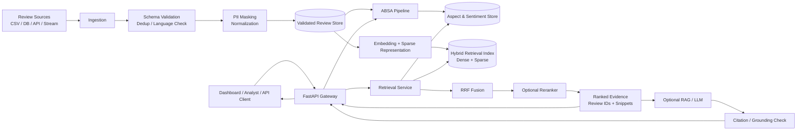
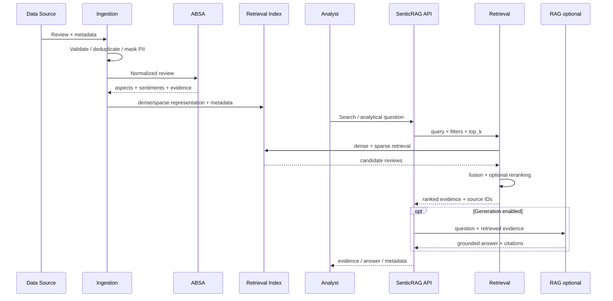
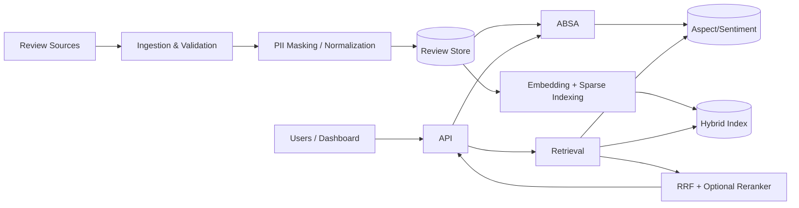
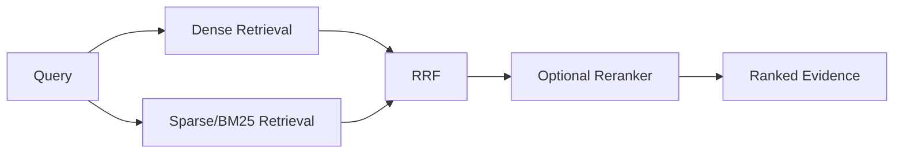

# Deep research: Designing `GIOI_THIEU_SAN_PHAM_VI.md` for SenticRAG with ABSA and Retrieval

English edition: 24 October 2026. This is a translation of the existing research report, not a new benchmark or source review. Original citation markers and historical filenames are retained for provenance; conversation-specific citation markers do not resolve as GitHub links. The primary-source URLs remain in the references table. Vietnamese JSON sample inputs and corresponding evidence/snippets are retained as language-specific example data, while report prose and the document template are in English.

## Executive summary

**Main conclusion:** `GIOI_THIEU_SAN_PHAM_VI.md` **should not be a single user story**, but it **should also go beyond a problem description**. The most suitable format is a **Problem-led Product Specification**: a product introduction and specification that starts with the business problem, then defines users, value, scope, high-level architecture, module contracts, representative user stories, acceptance criteria, nonfunctional requirements, data, operations, and success measures.

A user story describes a relatively small, valuable unit of functionality that can be implemented and tested; INVEST further requires stories to be Independent, Negotiable, Valuable, Estimable, Small, and Testable. The Product Goal and Product Backlog operate at a higher level, describing the product's future state and breaking it into smaller items. Turning all of `GIOI_THIEU_SAN_PHAM_VI.md` into one user story would therefore mix **product vision** with the **implementation backlog**. citeturn11search1turn11search7

The three existing documents also demonstrate why their purposes should be separated. `GIOI_THIEU_SAN_PHAM_VI.md` currently describes a **TMA Virtual Kiosk Assistant** for sales/demo purposes, rather than SenticRAG. fileciteturn0file0 Meanwhile, `README.md` defines SenticRAG as a feedback analysis system with **ABSA, hybrid Dense + BM25 retrieval, RRF, reranking, and citations**, with `/predict`, `/stats`, and `/ask` services. fileciteturn0file2 `Final_project(2).md` places SenticRAG in a target architecture with FastAPI, Postgres/Redis/Qdrant, pipelines, evaluation, Docker, observability, and production deployment, explicitly identifying some components as **a target state that has not been audited or verified as an existing implementation**. fileciteturn0file1

I therefore recommend **replacing the content** of `GIOI_THIEU_SAN_PHAM_VI.md` rather than extending the existing kiosk document.

**Recommended document roles:**

> `GIOI_THIEU_SAN_PHAM_VI.md` = product introduction and product-level specification explaining **why the product exists, who uses it, what each module does, its contracts, and what constitutes acceptance**.
> `README.md` = technical documentation for developers.
> `docs/architecture/*` = architecture details.
> `docs/model_cards/*` = model behavior/evaluation.
> `docs/data_cards/*` = data sources and governance.
> `docs/runbooks/*` = operations.

**Proposed product problem:**

> Businesses have large volumes of textual customer feedback but struggle to turn it into structured information and traceable evidence. SenticRAG transforms raw feedback into **aspect + sentiment**, enables **retrieval of relevant feedback**, and optionally uses a RAG layer to generate answers with **citations to original reviews**.

This definition aligns with classical ABSA: SemEval-2014 separates aspect/aspect-category identification and polarity rather than assigning a single sentiment to the entire text. citeturn11search8 It also follows the RAG principle of combining parametric knowledge with retrieved knowledge to improve knowledge freshness and provenance. citeturn14search7

**Assumptions used in this report:**

| Assumption | Basis / status |
| -------------------------------------------------------------------------------------------- | ----------------------------------------------------------------------------------------------------------------------------------------------------------------------------------------- |
| Customer reviews/feedback are the primary data | Inferred from the SenticRAG README and blueprint. fileciteturn0file2 |
| Vietnamese is the primary language, with possible English expansion | PhoBERT and the current taxonomy indicate a Vietnamese focus; bilingual support has not been established as a mandatory requirement. fileciteturn0file2 |
| The initial taxonomy contains `quality`, `price`, `delivery`, and `customer_service` | Based on the current README; version the taxonomy and do not treat it as the final ontology. fileciteturn0file2 |
| Retrieval returns ranked evidence; `/ask` generation is downstream | This is the proposed separation so retrieval can be evaluated independently. The README already includes `/ask` and citations. fileciteturn0file2 |
| FastAPI, Qdrant, and Redis/Postgres form the target stack | Described in the two project documents. fileciteturn0file1 fileciteturn0file2 |
| Production QPS, corpus size, hardware, latency, and F1/Recall measurements are unavailable | The supplied documents contain no verified benchmarks; numerical thresholds below are **proposed starting targets** that must be replaced with real benchmark results. |
| Claims of a 50% cost reduction or 100% accuracy lack supporting benchmarks | Such claims appear in the current README; exclude them from formal product documentation until reproducible evidence is available. fileciteturn0file2 |

## Assessment of the current document and recommended organization

The kiosk document communicates the user journey and product value clearly, but describes a different product: a bilingual voice kiosk, ASR/TTS, appointment scheduling, and a reception dashboard. fileciteturn0file0 For SenticRAG, **retain the focus on problems and value**, while replacing the domain, stakeholders, workflows, and acceptance criteria with those for ABSA + Retrieval.

A useful `GIOI_THIEU_SAN_PHAM_VI.md` for this project should answer six questions in order:

| Question | Required content |
| ----------------------------------------- | -------------------------------------------------------------------------------- |
| **Why?** | Customer/business problem and the consequences of leaving it unresolved |
| **Who?** | Users, beneficiaries, and accountable owners |
| **What?** | What ABSA and Retrieval do and do not do |
| **How does information flow?**      | Input, output, data source, pipeline, API, integration                           |
| **How good is good enough?**        | Business KPI, ML metrics, retrieval metrics, NFR, acceptance criteria            |
| **How do we trust and operate it?** | Data governance, privacy, security, monitoring, testing, deployment, limitations |

This also distinguishes a **user story** from a **product specification**. The Scrum Guide defines the Product Goal as a future product state; the Product Backlog is then refined into smaller, more precise items. A product has clear boundaries, stakeholders, and users/customers. citeturn11search1 User stories should therefore appear **within each module's section**, providing end-to-end examples and inputs to the backlog rather than structuring the entire file.

A suitable document structure is:

```text
GIOI_THIEU_SAN_PHAM_VI.md
│
├── Executive summary
├── Problem, context, and value
├── Scope and assumptions
├── Users / stakeholders
├── Goals and success metrics
├── Architecture overview
│
├── ABSA module
│   ├── Purpose
│   ├── Stakeholder
│   ├── Input / Output contract
│   ├── Data
│   ├── Pipeline
│   ├── Scenarios
│   ├── User stories
│   ├── Acceptance criteria
│   ├── NFR
│   ├── API / integration
│   ├── Deployment
│   ├── Monitoring
│   └── Testing
│
├── Retrieval module
│   └── [same structure]
│
├── Data governance & ethics
├── Security & privacy
├── Deployment & observability
├── Testing & release gates
├── Roadmap / activities
├── Limitations & risks
└── References
```

**Do not turn this file into a second README.** The current README already covers repository layout, quickstart, and Gitflow. fileciteturn0file2 `Final_project(2).md` provides detailed EKS, Helm, Terraform, ECR, CI/CD, and production runbooks. fileciteturn0file1 Include technical details in `GIOI_THIEU_SAN_PHAM_VI.md` only when they directly affect product contracts or acceptance.

A more appropriate opening than the existing kiosk introduction is:

```markdown
# SenticRAG — Aspect-Based Sentiment Analysis
# and Customer Feedback Intelligence Retrieval Platform

> SenticRAG helps businesses turn thousands of textual customer reviews
> into structured information by aspect,
> retrieve relevant evidence, and support answers
> that can be traced back to original feedback.

SenticRAG provides two core capabilities:

1. **ABSA (Aspect-Based Sentiment Analysis):**
   identify the aspects customers discuss and the sentiment
   expressed toward each aspect.

2. **Retrieval:**
   find and rank the feedback/evidence most relevant to
   a question or analytical need.

A RAG layer can use Retrieval results as evidence to
generate cited answers; Retrieval itself is designed and
evaluated as an independent module.
```

I also recommend replacing claims such as **production-ready, enterprise-grade, 100% accurate, eliminates hallucination, and reduces costs by 50%** with qualified statements and measurable metrics. The existing blueprint already identifies many elements as a target state and acknowledges missing benchmarks. fileciteturn0file1 Product documentation should distinguish targets, measured results, unmeasured results, and versions instead of presenting aspirations as facts.

## Project-level specification and proposed architecture

**Product-level goals** should describe outcomes rather than technologies:

> **Product Goal:** Help Product, Customer Experience, Customer Support, and Business Analyst teams understand *which issues customers discuss, how they feel, and where the supporting evidence is*, with results accurate, fast, traceable, and governable enough to support decisions.

This is a more durable abstraction than building PhoBERT + Qdrant: the model or database may change without changing the Product Goal. Similarly, the Scrum Guide treats the Product Goal as a long-term objective and places implementation details in the backlog. citeturn11search1

**Proposed stakeholder map:**

| Stakeholder | Value received | What they need to trust |
| ---------------------------- | ------------------------------------------------------ | -------------------------------------------------------- |
| Customer Experience Manager | Identify aspects with concentrated negative feedback | Accurate aspect/sentiment results with review drill-down |
| Product Manager | Find pain points by product/version/time | Correct filters and result provenance |
| Customer Support | Quickly find similar feedback | Fast, relevant retrieval |
| Business Analyst | Analyze trends, cohorts, and causes | Data lineage and a stable taxonomy |
| Data Scientist / ML Engineer | Train, evaluate, and improve ABSA/retrieval | Reproducible datasets, versions, models, and evaluations |
| Data Engineer | Ingest, validate, and index data | Clear schemas and failure handling |
| Platform/SRE | Operate services reliably | SLOs, metrics, tracing, and rollback |
| Security/Privacy/Legal | Reduce personal-data and AI risks | Access control, retention, audit, and governance |
| Management | Measure ROI and adoption | Business KPIs beyond model accuracy |

**Success metrics must cover multiple layers**, avoiding the common mistake of equating a high F1 score with product success:

| Layer | Recommended metrics | Example target |
| --------- | --------------------------------------------------------------------- | ------------------------------------------------------------------------- |
| Business | Time from question to insight, percentage of insights with evidence, adoption | Reduce manual analysis time; numerical targets require a measured baseline |
| ABSA | Macro-F1, per-aspect F1, confusion matrix, coverage | Example MVP Macro-F1 ≥ 0.80* |
| Retrieval | Recall@K, nDCG@K/MRR, zero-result rate, citation validity | Example Recall@10 ≥ 0.85* |
| System | p95 latency, throughput, availability, error rate, index freshness | Example ABSA p95 ≤ 300 ms*, Retrieval p95 ≤ 250 ms* |
| Data | Schema rejection, duplicate rate, PII leakage, label agreement, drift | Zero PII in application logs according to the test suite* |

\* **These numbers are MVP planning assumptions, not existing SenticRAG benchmarks.** Prefer `[TBD_AFTER_BASELINE]` placeholders initially and freeze values after the first benchmark sprint.

ISO/IEC 25010:2023 defines a product quality model with nine characteristics and supports its use in requirements, testing objectives, quality-control criteria, and acceptance criteria. NFRs should therefore cover reliability, security, maintainability, and other quality attributes in addition to latency. citeturn12search1turn12search12

**Proposed architecture:**



This is close to the target architecture described in the README and production blueprint, with separate ingestion/validation, ABSA, embeddings, Qdrant, retrieval, citation, API, and observability components. fileciteturn0file1 fileciteturn0file2 For retrieval, Qdrant supports hybrid dense + sparse search and RRF, matching the architecture selected for SenticRAG. citeturn11search2turn11search6

**End-to-end data flow:**



Retrieval should remain useful when the LLM is disabled. This reduces coupling, enables independent relevance benchmarks, and prevents plausible-sounding answers from concealing weak retrieval. This is a design recommendation; the original RAG principle also separates retrieval from non-parametric memory from the generation step. citeturn14search7

## ABSA module specification

Describe ABSA as a **product capability with an explicit contract**, rather than merely a PhoBERT model.

SemEval-2014 defines ABSA around target/aspect identification and the corresponding polarity, explaining why a review meaning 'the device looks good but delivery is far too slow' cannot be represented adequately by one sentiment label. citeturn11search8 For Vietnamese, PhoBERT is a monolingual pretrained model published by VinAI and ACL and is a reasonable encoder-based ABSA benchmark candidate. It cannot be assumed to be the best choice for SenticRAG without benchmarking the project's own dataset. citeturn12search0

**Purpose to state in the document:**

> The ABSA module transforms an unstructured review into a list of **mentioned aspects**, **sentiment for each aspect**, confidence, and optionally evidence spans. Results support dashboards, analytics, trend detection, filtering, and downstream Retrieval/RAG.

**Primary stakeholders:** CX, Product Managers, BAs, Support, and Data Science. CX/Product benefit from aggregate insights; Support/BAs benefit from drill-down; the ML team uses output quality metrics to improve the model.

**Proposed input contract** (Vietnamese sample text and matching evidence spans are preserved as language-specific example data):

```json
{
  "review_id": "RV-000123",
  "text": "Máy rất đẹp nhưng giao hàng quá chậm.",
  "language": "vi",
  "metadata": {
    "product_id": "P01",
    "channel": "ecommerce",
    "rating": 3,
    "created_at": "2026-09-20T10:00:00+07:00"
  }
}
```

The minimum fields should be `review_id` and `text`; models must not implicitly depend on metadata unless the model card documents that dependency.

**Proposed output contract:**

```json
{
  "review_id": "RV-000123",
  "language": "vi",
  "taxonomy_version": "aspect-v1",
  "model_version": "absa-phobert-2026-09-001",
  "aspects": [
    {
      "aspect": "product_quality",
      "sentiment": "positive",
      "confidence": 0.91,
      "evidence": "Máy rất đẹp"
    },
    {
      "aspect": "delivery",
      "sentiment": "negative",
      "confidence": 0.97,
      "evidence": "giao hàng quá chậm"
    }
  ]
}
```

Return `model_version` and `taxonomy_version`: historical analytics become difficult to explain if model or taxonomy changes cannot be traced through output versions.

**Data sources.** Prioritize production data owned by the organization or covered by processing rights, with versioning and lineage. For Vietnamese research, UIT-ViSFD is a useful reference: its repository describes 11,122 smartphone feedback records, 10 aspects, and 3 polarities, divided into train/dev/test splits. The authors also ask companies to contact them for commercial use. Public availability must not be equated with unrestricted commercial production use. citeturn12search2

**Document the processing pipeline explicitly:**

```text
Raw review
   ↓
Schema validation
   ↓
PII masking
   ↓
Unicode / whitespace normalization
   ↓
Language detection / routing
   ↓
Aspect detection
   ↓
Sentiment per detected aspect
   ↓
Optional evidence-span extraction
   ↓
Confidence / schema validation
   ↓
Store + API response
   ↓
Monitoring / drift statistics
```

The taxonomy must be a versioned artifact, for example:

```yaml
taxonomy_version: aspect-v1

aspects:
  - product_quality
  - price
  - delivery
  - customer_service

sentiments:
  - positive
  - neutral
  - negative
```

These four aspects reflect the current README's direction and have not been established as a complete production ontology. fileciteturn0file2

**ABSA model comparison:**

| Option | Strengths | Limitations | Compute | Recommended role |
| ---------------------------- | --------------------------------------------------------------------------------------------------- | ---------------------------------------------------------------------------------- | ---------------- | --------------------------------------------------------------------------------------------------------- |
| TF-IDF + Logistic Regression | Simple, fast, easy to baseline and debug | Limited semantic/contextual representation | Low, CPU | **Retain as a mandatory baseline**; the README already identifies this candidate. fileciteturn0file2 |
| Fine-tuned PhoBERT | Vietnamese-specific pretrained encoder; suitable for downstream Vietnamese NLP benchmarks | Heavier training/inference than the baseline; requires fine-tuning and monitoring | Medium | Primary Vietnamese-data candidate, subject to benchmarking. citeturn12search0 |
| viBERT-class model | Already included in the project's candidate set | No SenticRAG benchmark supplied | Medium | Compare using the same splits/evaluation harness. fileciteturn0file2 |
| Multilingual Transformer | Useful for a genuinely Vietnamese–English/code-switching corpus | May require more resources and does not automatically outperform Vietnamese models | Medium/high | Add only when a business requirement confirms multilingual support |
| LLM structured extraction | Flexible ontology; easy prototyping or labeling assistance | Higher latency/cost; outputs require validation and are harder to control than classifiers | High/variable | Weak labeling, adjudication, or fallback; not the default when a classifier meets requirements |

This is a **decision matrix**, not a measured quality ranking. Select the winning candidate using a versioned test set, latency benchmarks, and cost profiles on actual hardware.

**Concrete usage scenarios:**

> A week brings 40,000 reviews. Instead of reading each one, a CX Manager views the negative-sentiment rate for `delivery`, detects a spike, drills down to original reviews, and forwards the evidence to operations.

> A Product Manager filters `product_id=P01`, aspect `product_quality`, and sentiment `negative`, then compares trends before and after a release.

> Retrieval can use ABSA-generated aspect/sentiment filters to answer: 'What negative delivery complaints were raised this month?'

**Example ABSA user story:**

> **As a Customer Experience Manager**, I want the system to identify each aspect mentioned in feedback and its sentiment automatically, **so I can identify the sources of negative experiences without manually reading every review**.

This story focuses on the user and value; implementation choices such as PhoBERT do not belong in it. INVEST emphasizes that user stories must be valuable, small enough, and testable. citeturn11search7

**Example ABSA acceptance criteria:**

| ID | Given / When / Then | Criterion |
| ---------- | --------------------------------------------------------------------------------------------- | -------------------------------------------------------------------------------------------------------- |
| ABSA-AC-01 | Given a review meaning 'The device looks good but delivery is far too slow', when `/predict` is called | Output includes at least `product_quality=positive` and `delivery=negative` under the approved taxonomy |
| ABSA-AC-02 | Given a valid request | Response conforms to the JSON schema and includes `review_id`, `model_version`, and `taxonomy_version` |
| ABSA-AC-03 | Given a review containing no taxonomy aspect | The model is not forced to invent an aspect; define `[]`/`other` behavior explicitly |
| ABSA-AC-04 | Given a malformed payload | API returns a structured validation error without running inference |
| ABSA-AC-05 | Given a frozen evaluation set | Macro-F1 ≥ release threshold; **assumed MVP value: 0.80**, to be revised after baseline measurement |
| ABSA-AC-06 | Given a critical aspect | Per-aspect F1 meets its floor; **assumed MVP value: 0.75** |
| ABSA-AC-07 | Given target production hardware | Inference p95 ≤ **an assumed 300 ms**, after warm-up and for the specified payload length |
| ABSA-AC-08 | Given a request containing PII | Raw PII does not appear in application logs after the masking policy is applied |
| ABSA-AC-09 | Given two model versions | The dashboard/report identifies which version generated each output |
| ABSA-AC-10 | Given an unsupported language | The service returns an explicit status instead of silently applying the Vietnamese model |

**Proposed integration/API:**

```http
POST /v1/absa/predict
POST /v1/absa/predict:batch
GET  /v1/absa/models/current
GET  /v1/absa/taxonomy
GET  /health/ready
```

Specify `max_batch_size` explicitly; large offline workloads should use pipelines/jobs rather than one enormous HTTP request.

**Deployment.** The TF-IDF baseline can run with modest CPU resources; benchmark Transformer CPU/GPU performance before choosing a node class. The production blueprint proposes Dockerized services with separate release/scaling boundaries, but EKS/Helm/Terraform must remain labeled as the **target deployment architecture** without real deployment evidence. fileciteturn0file1

**ABSA observability** should track `request_count`, error rate, p50/p95/p99 inference latency, model/taxonomy version, aspect frequency, predicted-label and confidence distributions, input length, unsupported-language rate, and drift indicators. OpenTelemetry supports traces, metrics, and logs for end-to-end correlation. citeturn14search1

**ABSA testing:**

| Type | Coverage |
| ---------------- | -------------------------------------------------------------------------------------------- |
| Unit             | normalizer, taxonomy mapping, schema validation, PII masker, post-processing                 |
| Integration      | API → model artifact → output schema → database                                           |
| Data validation  | nulls, duplicates, language, label validity, split leakage, PII                              |
| ML validation | Macro-F1, per-aspect F1, confusion matrix, slices by product/channel/text length |
| Regression | Candidate metrics must not fall below release floors relative to the production baseline |
| Performance      | p50/p95/p99, throughput, RAM/VRAM, cold/warm behavior                                        |
| Robustness | Typos, emoji, slang, code-switching, negation, very long/short text |
| Privacy/security | log-redaction test, auth, unauthorized access, malformed payload                             |

## Retrieval module specification

Retrieval should not be described merely as vector search. Its actual contract is:

> Given a query and optional filters, return **ranked evidence** with `review_id`, snippet, metadata, score/rank, and `index_version`, so downstream analytics or RAG can verify the sources.

The current README selects hybrid Dense + BM25 retrieval, RRF, and a reranker on Qdrant. fileciteturn0file2 This is suitable for reviews: lexical retrieval handles exact terms/IDs, while dense retrieval adds semantic matching. Qdrant officially supports sparse/dense hybrid queries. citeturn11search11turn11search6

**Proposed input contract** (the Vietnamese query and returned snippet are preserved as example data):

```json
{
  "query": "Khách hàng phàn nàn gì về giao hàng trong tháng 9?",
  "top_k": 10,
  "filters": {
    "date_from": "2026-09-01",
    "date_to": "2026-09-30",
    "aspect": ["delivery"],
    "sentiment": ["negative"]
  },
  "rerank": true
}
```

**Proposed output contract:**

```json
{
  "query_id": "Q-20260929-001",
  "index_version": "reviews-2026-09-28-v3",
  "latency_ms": 87,
  "hits": [
    {
      "rank": 1,
      "review_id": "RV-002471",
      "score": 0.842,
      "snippet": "Đơn giao chậm hơn lịch dự kiến bốn ngày...",
      "source": "ecommerce",
      "metadata": {
        "product_id": "P01",
        "aspect": ["delivery"],
        "sentiment": ["negative"],
        "created_at": "2026-09-18T08:21:00+07:00"
      }
    }
  ]
}
```

Do not present a score to business users as '84.2% correct': dense similarity, BM25, RRF, and reranker scores have different meanings. RRF combines ranked lists without requiring relevance scores to share a scale. citeturn14search0

**Data/index pipeline:**

```text
Validated review
      ↓
Chunking policy
      ↓
Metadata enrichment
      ├── review_id
      ├── product/channel/date
      └── ABSA aspect/sentiment
      ↓
Dense embedding ───────┐
                        ├── Hybrid index
Sparse/BM25 form ──────┘
      ↓
Payload/filter indexes
      ↓
Versioned index
      ↓
Golden-query evaluation
      ↓
Promote index version
```

For short reviews, one review may be one retrieval unit. Long-document sources require an explicit chunking strategy; do not apply an arbitrary tutorial chunk size to every data type.

**Retrieval method comparison:**

| Method | Strengths | Weaknesses | Suitable use | Recommendation |
| --------------------- | -------------------------------------------------------------------- | -------------------------------------------------------------------- | ---------------------------------------------------------- | ---------------------------------------------------------------------------------------------------------------------------------------------------------- |
| BM25 / sparse lexical | Keywords, product names, codes, specific phrases | May miss paraphrases or queries using different vocabulary | Exact search, baseline | Retain as a baseline and hybrid branch; BM25 is a common lexical scoring method based on term/document statistics. citeturn15search0turn15search5 |
| Dense vector | Semantic similarity, paraphrases | Exact IDs/rare terms may be underweighted; requires embedding compute | Natural-language search | Use as the semantic branch |
| Hybrid Dense + Sparse | Captures semantic and lexical evidence | Greater complexity/index size; requires fusion | Review corpora with natural-language queries and entities/keywords | **Default recommendation** for SenticRAG; Qdrant supports both representations. citeturn11search11 |
| Hybrid + RRF | Rank-based fusion without compatible score scales | Requires candidate-depth/rank-window tuning | Two or more retrievers | **Default fusion** until evidence supports another choice. citeturn14search0turn11search6 |
| Hybrid + reranker | Can improve top-candidate ordering with a suitable reranker | Additional model calls and latency | Accuracy-sensitive top-N results | Enable only when held-out evaluation demonstrates gains; Qdrant also recommends evaluating reranking on evaluation data. citeturn11search10 |

**Indexing comparison:**

| Index | Purpose | Trade-off | Role in SenticRAG |
| ---------------------- | --------------------------------------- | ----------------------------------------------- | ----------------------------------------------------------------------------------------------------------------------------------------------- |
| Inverted/sparse index | Lexical retrieval | Does not replace semantic vector retrieval | BM25/sparse branch |
| Exact/full vector scan | Exact nearest-neighbor baseline | Cost rises substantially with corpus size | Small benchmarks or correctness reference |
| HNSW | Approximate dense nearest-neighbor search | RAM/index-build costs and recall–latency tuning | Default dense index with Qdrant, which uses HNSW for dense vector indexing. citeturn15search12 |
| Payload index | Filtering by aspect/date/product/channel | Additional storage/index management | Essential for heavy filtering; Qdrant recommends indexing filter fields before ingestion. citeturn11search5turn15search9 |

HNSW parameters such as `m`, `ef_construct`, and query-time `ef` affect build/search behavior. Tune them through benchmarks rather than copying them blindly from another project. citeturn15search12

**Example Retrieval user story:**

> **As a Product Manager**, I want to ask 'What are customers complaining about regarding P01 delivery this month?' and receive the most relevant feedback with provenance, **so I can verify insights before making decisions**.

An analyst story:

> **As a Business Analyst**, I want to filter results by time, product, aspect, and sentiment, **so I can analyze the same query by cohort without exporting all data and filtering manually**.

A downstream RAG story:

> **As an `/ask` user**, I want every important claim in an answer linked to retrieved reviews/evidence, **so I can distinguish supported content from model inference**.

**Example Retrieval acceptance criteria:**

| ID        | Acceptance criterion                                                                                                            |
| --------- | ------------------------------------------------------------------------------------------------------------------------------- |
| RET-AC-01 | Valid requests return ranked `hits[]` containing `review_id`, `snippet`, `metadata`, and `index_version` |
| RET-AC-02 | `product_id/aspect/sentiment/date` filters never return items that violate the filters |
| RET-AC-03 | On a versioned golden-query set, **assumed MVP Recall@10 ≥ 0.85**; freeze the threshold after baseline measurement |
| RET-AC-04 | **Assumed MVP nDCG@10 ≥ 0.75** when the dataset has graded relevance |
| RET-AC-05 | 100% of returned `review_id` values resolve to existing source records |
| RET-AC-06 | Queries without sufficiently strong evidence may return empty/insufficient results instead of being forced to return hits |
| RET-AC-07 | Search without reranking has **an assumed p95 ≤ 250 ms** on the corpus/hardware baseline documented in the benchmark |
| RET-AC-08 | Enable a production reranker only when held-out quality gains justify latency/cost under the release criterion |
| RET-AC-09 | Every index build records `index_version`, embedding model version, and source-data snapshot/version |
| RET-AC-10 | Do not promote an index candidate when golden-query regression exceeds tolerance |
| RET-AC-11 | Query PII/sensitive logs comply with the redaction policy |
| RET-AC-12 | When the index is unready/rebuilding, readiness and errors reflect its actual state instead of silently serving a partial index |

Do not choose an arbitrary `score_threshold` before obtaining labeled data. Qdrant warns that applying a threshold copied from dense-only search to fused scores may silently truncate results; derive thresholds from actual evaluation. citeturn11search5

**Proposed API:**

```http
POST /v1/retrieval/search
POST /v1/retrieval/search:batch
GET  /v1/retrieval/indexes/current
GET  /v1/retrieval/indexes/{version}/status

POST /v1/ask
GET  /health/ready
```

Keep these responsibilities distinct:

```text
/retrieval/search
    query
      ↓
    ranked evidence
      ↓
    DONE

/ask
    query
      ↓
    retrieval
      ↓
    evidence
      ↓
    LLM
      ↓
    citation validation
      ↓
    natural-language answer
```

Retrieval quality and generation quality have different failure modes. The blueprint also proposes separate retrieval evaluation using Recall@K/MRR/citations and generation evaluation using groundedness. fileciteturn0file1

**Retrieval monitoring** should include end-to-end and stage latency (`embedding_ms`, `sparse_ms`, `dense_ms`, `fusion_ms`, `rerank_ms`), zero-result rate, result count, index age, indexed-document count, `index_version`, filter usage, cache hits, dependency errors, and offline retrieval metrics. In distributed services, trace propagation correlates spans for the same request across services. citeturn14search1turn14search12

**Retrieval testing:**

| Type | Tests |
| ---------------- | --------------------------------------------------------------------------------- |
| Unit             | query normalization, filter construction, RRF, rank handling, citation formatting |
| Integration      | ingestion → Qdrant → query → source resolution                                 |
| Contract         | stable request/response schema                                                    |
| Retrieval eval | Recall@K, MRR, nDCG@K on golden queries |
| Filter eval | Exact correctness of product/aspect/date filters |
| Index validation | point count, vector/index state, embedding/index version compatibility            |
| Regression       | compare candidate vs current production index                                     |
| Performance      | cold/warm p50/p95/p99, concurrency, corpus-size scaling                           |
| Failure          | Qdrant unavailable, timeout, partial index, malformed filter                      |
| Security         | unauthorized queries, injection-like metadata/filter payloads, PII logging        |

## Cross-cutting requirements: data, NFRs, security, deployment, and operations

**Data governance** needs more than a generic data-security paragraph. Every dataset/index/model must answer:

```text
Where does the data come from?
Who owns it?
What is its intended use?
Are use / training / commercial-use rights available?
Does it contain PII?
Which PII is retained, masked, or deleted?
Who can access it?
Which version is in use?
What is the retention period?
How can a data subject's data or a source record be deleted?
Which models/indexes were built from which data versions?
```

In Vietnam, Personal Data Protection Law No. 91/2025/QH15 was issued on 26 June 2025 and took effect on **1 January 2026**. Reviews processed by this project may contain names, phone numbers, addresses, account identifiers, or personal content, so data governance must be treated as a product requirement rather than only security hardening. citeturn13search0turn13search14

As of 29 September 2026, Artificial Intelligence Law No. 134/2025/QH15 had also taken effect on **1 March 2026**. Government sources describe a focus on people, safety, human rights, and human control, and identify discriminatory or unlawful AI uses. SenticRAG's specific obligations depend on its actual use cases, data, and risk classification. Product documentation should identify a legal/compliance owner rather than declare full compliance without verification. citeturn13search1turn13search4

An example governance table:

| Asset          | Owner      | Sensitivity            | Retention                 | Versioning                     | Controls              |
| -------------- | ---------- | ---------------------- | ------------------------- | ------------------------------ | --------------------- |
| Raw reviews | Data Owner | May contain PII | `[TBD]` | Source snapshot | Restricted access |
| Masked reviews | Data/ML    | internal               | `[TBD]`                 | dataset manifest               | role-based            |
| Labels | ML/Product | Internal | Aligned with dataset retention | Label schema version | Audit changes |
| ABSA model | ML | Internal IP | Until deprecated | Model version/hash | Controlled promotion |
| Embeddings | ML/Data | Derived sensitive data | No longer than source retention | Embedding model + data version | Controlled access |
| Qdrant index   | Platform   | derived data           | rebuildable               | index version                  | backup/access control |
| Query logs | Platform | Potentially sensitive | Short, purpose-specific retention | Daily partitions | Redact/hash PII |

**Ethics and Responsible AI.** NIST AI RMF organizes AI risk management into Govern, Map, Measure, and Manage, emphasizing lifecycle risk management rather than only model evaluation before release. citeturn12search3turn12search7 ISO/IEC 42001:2023 also places AI in a management system covering risk, governance, transparency, and continuous improvement. citeturn12search8 SenticRAG should explicitly address bias across dialects/channels/product groups, sentiment-model errors, avoiding unsupported inference of sensitive attributes from sentiment, human review for important decisions, evidence traceability, and data correction/removal mechanisms.

**Proposed NFR matrix:**

| Category | Proposed requirement |
| --------------- | ------------------------------------------------------------------------------------------------ |
| Performance     | ABSA p95 ≤ 300 ms*; Retrieval no-rerank p95 ≤ 250 ms*                                          |
| Throughput | Benchmark QPS on fixed hardware; do not claim high scalability without measurements |
| Scalability | Scale services and indexes independently; benchmark at least the current corpus and 3× and 10× data volumes |
| Availability | API availability target of 99.5–99.9%*, depending on business criticality |
| Reliability | Explicit timeouts/retries/fallbacks; no silent partial results |
| Security        | authentication, authorization, least privilege, TLS, rate limit, secret management               |
| Privacy         | data minimization, PII masking/redaction, access/retention/deletion policy                       |
| Traceability | Every output includes relevant model/index/taxonomy versions |
| Maintainability | typed contracts, versioned config, CI tests, reproducible artifacts                              |
| Portability | Docker image; environment-specific configuration outside the image |
| Observability   | traces + metrics + logs; release/model/index dimensions                                          |
| Recoverability | Backup/snapshot/rebuild procedures; rollback to previous model/index versions |
| Data freshness | Index freshness SLO, for example <15-minute batches*, or as required by the product |

\* Assumed starting target.

Use ISO/IEC 25010:2023 as a checklist to avoid missing quality requirements while optimizing performance. citeturn12search12

**Security/privacy design:**

```text
Internet / Internal Client
          ↓
 Auth + Rate Limit
          ↓
       API Layer
          ↓
  ┌───────┴────────┐
 ABSA          Retrieval
  │                 │
 Model          Qdrant Index
  │                 │
  └──── audit/telemetry ────┐
                             ↓
                    Redacted Observability

Raw data → PII masking → internal processed data
              │
              └── sensitive mapping access restricted
```

Do not log entire reviews by default merely for debugging convenience. Focus logs on request IDs, model/index versions, timings, error categories, and nonsensitive aggregate dimensions.

**Deployment recommendations by maturity level:**

| Stage                   | ABSA                                | Retrieval                        | Infrastructure                            |
| ----------------------- | ----------------------------------- | -------------------------------- | ----------------------------------------- |
| Developer               | local artifact                      | local Qdrant                     | Docker Compose                            |
| CI                      | lightweight/test artifact           | ephemeral test index             | isolated runner                           |
| Staging                 | release candidate                   | staging index snapshot           | containerized environment                 |
| Production | Immutable model/application version | Promoted immutable index version | Target Kubernetes/EKS if actually needed |
| Batch training/indexing | separate job                        | separate build/index job         | independent scheduling                    |

The production blueprint selects EKS, Helm, Terraform, ECR, S3 artifacts, and independent scaling boundaries as its target state. fileciteturn0file1 `GIOI_THIEU_SAN_PHAM_VI.md` should describe deployment targets rather than reproduce hundreds of Kubernetes YAML lines.

**Observability hierarchy:**

```text
Business
    time-to-insight / adoption / issue trends
        ↓
ML quality
    F1 / Recall@K / nDCG / drift
        ↓
Application
    latency / errors / throughput / versions
        ↓
Dependencies
    Qdrant / DB / Redis / external LLM
        ↓
Infrastructure
    CPU / memory / GPU / disk / network
```

OpenTelemetry supports traces, metrics, and logs, providing a suitable abstraction for correlating requests across ABSA, Retrieval, and downstream RAG. citeturn14search1

**Release gates should require both software quality and ML/data quality:**

```text
Code changes
   ↓
lint / type / unit
   ↓
integration tests
   ↓
data validation
   ↓
ABSA or retrieval regression
   ↓
security checks
   ↓
staging smoke
   ↓
latency/load gate
   ↓
promotion
   ↓
post-deploy monitoring
```

A model with high Macro-F1 that increases p95 latency fivefold is not automatically a good release. Similarly, a faster index should not be promoted if Recall@10 drops substantially. Quality gates must therefore assess multiple dimensions.

## Ready-to-use `GIOI_THIEU_SAN_PHAM_VI.md` template

The following skeleton is the recommended replacement. It provides enough detail for BA/Product/Engineering to agree on contracts without repeating the implementation guide. The template is in English; Vietnamese JSON sample inputs and matching outputs remain unchanged to illustrate the language-specific contracts. Historical filenames are retained as source references.

````markdown
---
title: "SenticRAG — Product introduction and product-level specification"
language: "en"
status: "draft"
version: "0.1.0"
owner: "Product / AI Engineering"
last_updated: "2026-09-29"
---

# SenticRAG — Aspect-Based Sentiment Analysis
# and Customer Feedback Intelligence Retrieval

> **Document status:** Draft
>
> **Purpose:** Explain SenticRAG's problem, users, value,
> contracts, and success criteria.
>
> Detailed implementation guidance is maintained in
> `docs/architecture/`, `docs/model_cards/`,
> `docs/data_cards/`, and `docs/runbooks/`.

## Executive summary

SenticRAG helps organizations transform large volumes of textual
customer feedback into structured insights and evidence
that can be traced to its source.

The product provides two core capabilities:

- **ABSA:** identify which aspects customers discuss
  and their sentiment toward each aspect.
- **Retrieval:** find and rank the feedback most relevant
  to a query and its filters.

An optional RAG layer can use evidence returned by Retrieval
to generate answers with citations.

## Problem to solve

Product, Customer Experience, and Business Analysis teams
regularly process large volumes of unstructured reviews.

Typical questions include:

- Which issues are customers dissatisfied with?
- Are delivery issues increasing or decreasing this month?
- What specific evidence supports that conclusion?
- Which feedback resembles the current question or complaint?

Reading and classifying every review manually is time-consuming,
difficult to keep consistent, and difficult to scale.

SenticRAG provides a measurable, traceable pipeline
that transforms reviews into aspects/sentiments and ranked evidence.

## Scope

### In scope

- ingest and validate customer reviews;
- mask personal data according to policy;
- ABSA;
- hybrid Retrieval;
- metadata filters;
- versioned model/index;
- evaluation;
- API;
- observability;
- optional grounded RAG.

### Currently out of scope

- automatically executing decisions that directly affect customers;
- treating sentiment output as an absolute conclusion;
- using data without processing rights;
- inferring sensitive attributes from sentiment.

## Users and stakeholders

| Role | Need |
|---|---|
| CX Manager | View sentiment by aspect and drill down |
| Product Manager | Understand each product's pain points |
| Business Analyst | Find evidence and trends |
| Customer Support | Find similar feedback |
| Data/ML | Train and evaluate models |
| Platform/SRE | Operate services reliably |
| Security/Privacy | Control data and access |

## Product goal

**Product Goal:**

Help business teams answer:

> "What are customers saying, how do they feel,
> and where is the supporting evidence?"

with measurable, traceable, and governable results.

## Success metrics

| Category | Metric | Target |
|---|---|---|
| Business | time-to-insight | TBD |
| ABSA | Macro-F1 | TBD after baseline measurement |
| ABSA | per-aspect F1 | TBD |
| Retrieval | Recall@10 | TBD |
| Retrieval | nDCG@10 | TBD |
| System | ABSA p95 latency | TBD |
| System | Retrieval p95 latency | TBD |
| Reliability | error rate | TBD |
| Data | PII leakage in logs | 0 according to the test suite |

Do not publish official targets before benchmarking on datasets
and hardware representative of the production environment.

## Architecture overview



## ABSA module

### Purpose

Transform reviews into one or more aspects and their
corresponding sentiments.

### Input

```json
{
  "review_id": "RV-000123",
  "text": "Máy đẹp nhưng giao hàng quá chậm.",
  "language": "vi",
  "metadata": {
    "product_id": "P01"
  }
}
```

### Output

```json
{
  "review_id": "RV-000123",
  "taxonomy_version": "aspect-v1",
  "model_version": "MODEL_VERSION",
  "aspects": [
    {
      "aspect": "product_quality",
      "sentiment": "positive",
      "confidence": 0.91,
      "evidence": "Máy đẹp"
    },
    {
      "aspect": "delivery",
      "sentiment": "negative",
      "confidence": 0.97,
      "evidence": "giao hàng quá chậm"
    }
  ]
}
```

### Initial taxonomy

```yaml
aspects:
  - product_quality
  - price
  - delivery
  - customer_service

sentiments:
  - positive
  - neutral
  - negative
```

This taxonomy is an initial assumption and must be confirmed
with the domain owner.

### User story

**As a Customer Experience Manager,**
I want the system to classify sentiment automatically for each
aspect,
**so I can identify the sources of negative feedback
without reading every review manually.**

### Acceptance criteria

- responses conform to the schema;
- every output includes model/taxonomy versions;
- reviews with multiple aspects can return multiple labels;
- no aspect is forced when evidence is absent;
- Macro-F1 and per-aspect F1 exceed release thresholds;
- latency meets its target on documented hardware;
- raw PII does not appear in logs.

### API

```text
POST /v1/absa/predict
POST /v1/absa/predict:batch
GET  /v1/absa/taxonomy
GET  /v1/absa/models/current
```

### Monitoring

Track:

- latency;
- error rate;
- model version;
- aspect distribution;
- sentiment distribution;
- confidence distribution;
- data/concept drift;
- PII-redaction failures.

### Testing

- unit tests;
- schema/contract tests;
- integration tests;
- dataset validation;
- offline ML evaluation;
- slice tests;
- regression tests;
- load tests;
- privacy/security tests.

## Retrieval module

### Purpose

Accept a query and filters, then return the most relevant
source records in relevance order.

Retrieval does not require LLM generation.

### Input

```json
{
  "query": "Khách hàng phàn nàn gì về giao hàng?",
  "top_k": 10,
  "filters": {
    "aspect": ["delivery"],
    "sentiment": ["negative"]
  },
  "rerank": true
}
```

### Output

```json
{
  "query_id": "Q-001",
  "index_version": "INDEX_VERSION",
  "hits": [
    {
      "rank": 1,
      "review_id": "RV-002471",
      "score": 0.842,
      "snippet": "Đơn giao chậm hơn lịch dự kiến...",
      "metadata": {
        "aspect": ["delivery"],
        "sentiment": ["negative"]
      }
    }
  ]
}
```

### Retrieval pipeline



### User story

**As a Product Manager,**
I want to find the reviews most relevant to my question
and view their original sources,
**so I can verify insights before making decisions.**

### Acceptance criteria

- every hit includes a review/source ID;
- filters work correctly;
- golden-query Recall@K meets the release threshold;
- the index version is always returned;
- results are not forced when evidence is insufficient;
- latency meets the SLO;
- new indexes are not promoted when regression tests fail.

### API

```text
POST /v1/retrieval/search
POST /v1/retrieval/search:batch
GET  /v1/retrieval/indexes/current
```

### Monitoring

Track:

- total retrieval latency;
- embedding latency;
- sparse/dense search latency;
- fusion/reranking latency;
- zero-result rate;
- index freshness;
- index version;
- source-resolution failures;
- offline Recall@K / nDCG.

### Testing

- query/filter unit tests;
- Qdrant integration tests;
- golden-query evaluation;
- index-validation tests;
- regression tests;
- load tests;
- timeout/failure tests.

## Data Governance

Every data source must have:

- owner;
- purpose;
- legal/licensing status;
- sensitivity classification;
- PII policy;
- lineage;
- version;
- retention policy;
- access policy;
- deletion procedure.

Model and index artifacts must be traceable to the
dataset/config versions used to create them.

## Security and Privacy

Follow these design principles:

- data minimization;
- least privilege;
- authentication and authorization;
- encryption in transit/at rest;
- no secrets in source code;
- no raw PII in logs;
- audit privileged access;
- bounded retention periods.

Specific legal obligations must be confirmed by the privacy/legal
owner for the deployment context.

## Deployment

Target architecture:

```text
Containerized services
        ↓
Staging
        ↓
Quality / security / latency gates
        ↓
Production
        ↓
Observability
        ↓
Rollback if required
```

ABSA, Retrieval, workers, and offline pipelines should have
release/scaling boundaries suited to their workloads.

## Release Criteria

Promote a release only when:

1. unit/integration tests pass;
2. data validation pass;
3. ML/retrieval regression gates pass;
4. security checks pass;
5. API smoke tests pass;
6. latency/load target pass;
7. artifact versions are recorded;
8. a rollback target exists.

## Limitations

SenticRAG supports decision-making and does not fully replace
human judgment.

ABSA can misclassify sentiment, especially with sarcasm, slang,
very short reviews, or domains absent from training data.

Retrieval can miss evidence; evaluate its quality on a
golden-query set and monitor it continuously.

Do not interpret confidence scores as absolute probabilities unless
the model has been validated/calibrated for that purpose.

## Roadmap

| Phase       | Deliverable                           |
| ----------- | ------------------------------------- |
| Discovery   | taxonomy, stakeholder, data inventory |
| Data        | ingestion, validation, labeling rules |
| Baseline    | TF-IDF/BM25 baselines                 |
| ABSA        | candidate models + evaluation         |
| Retrieval   | dense/sparse/hybrid evaluation        |
| Integration | APIs + storage + dashboard            |
| Hardening   | privacy, security, observability      |
| Validation  | UAT, load, regression                 |
| Release     | versioned production candidate        |

## References

See the project's authoritative source list in
`docs/references.md`.

````

This structure also establishes a useful boundary: **acceptance criteria in the product document are externally observable contracts**; implementation tasks such as writing a QdrantClient class, configuring a Helm chart, or fine-tuning checkpoint X belong in issues/the backlog.

## Implementation roadmap, references, and next steps

A practical MVP roadmap should establish baselines before introducing complex techniques. The timeline below is a **planning assumption**, not a committed estimate: team size, data cleanliness, and repository readiness are unknown.

| Phase | Assumed duration | Activities | Exit criteria |
|---|---:|---|---|
| Discovery & product framing | Week 1 | Stakeholder interviews, problem statement, taxonomy, success metrics, scope | Product Goal + taxonomy v0 + metric definitions |
| Data audit & governance | Weeks 1–2 | Inventory, PII, licensing, schemas, labeling policy | Data card + validated sample |
| Baselines | Weeks 2–3 | TF-IDF ABSA baseline, BM25 retrieval baseline | Reproducible baseline reports |
| ABSA candidates | Weeks 3–5 | PhoBERT/viBERT candidates, error/slice analysis | Model candidate passes the agreed gate |
| Retrieval candidates | Weeks 4–6 | Dense, hybrid, RRF, optional reranking | Golden-query benchmark |
| API & integration | Weeks 5–7 | `/predict`, `/search`, storage/version contracts | E2E staging scenario |
| Quality & operations | Weeks 7–8 | Monitoring, privacy tests, latency/load, rollback | Passing release gates |
| UAT & documentation | Weeks 8–9 | Analyst/CX evaluation, documentation, limitations | Stakeholder sign-off |
| Production hardening | +2–4 weeks if needed | HA, autoscaling, disaster recovery, security hardening | Production readiness evidence |

**Establish baselines first.** Keep TF-IDF/Logistic Regression as the ABSA control and BM25 as the Retrieval control. Add Transformers, dense retrieval, hybrid fusion, and reranking only when they produce measurable improvements. Qdrant also recommends making tuning decisions from evaluation results and adding reranking only when improvements hold on held-out queries. citeturn11search10

**Recommended next steps, in order:**

| Priority | Decision to finalize | Output artifact |
|---|---|---|
| Immediate | Replace the kiosk content in `GIOI_THIEU_SAN_PHAM_VI.md` with a SenticRAG product specification | Document v0.1 |
| Immediate | Confirm the domain and aspect taxonomy with the business owner | `aspect_taxonomy_v1.yaml` |
| Immediate | Define the canonical review schema and PII policy | Data contract + data card |
| Next | Build an ABSA baseline and freeze the test split | `absa_baseline_report.json` |
| Next | Create 100–300+ golden retrieval queries with relevance judgments, subject to resources | Retrieval evaluation dataset |
| After baseline | Benchmark BM25 vs Dense vs Hybrid RRF | Retrieval benchmark report |
| After benchmarking | Decide whether a reranker is needed | ADR |
| Before release | Replace all `[TBD]` SLOs/metrics with actual measurements | Acceptance matrix |
| Before production | Audit production-readiness, cost-reduction, and accuracy claims | Evidence-backed product copy |
| Operations | Version the model, taxonomy, embedding model, index, and dataset | Release manifest |

The golden-query set is essential. Without relevance labels, retrieval architecture decisions can become subjective. Qdrant recommends tuning pipelines using evaluation data and warns that many settings can affect recall without triggering technical errors. citeturn11search5turn11search10

**Primary/authoritative sources to include in `docs/references.md`:**

| Topic | Authoritative source |
|---|---|
| ABSA canonical task | [SemEval-2014 Task 4 — ACL Anthology](https://aclanthology.org/S14-2004/) citeturn11search8 |
| Vietnamese NLP | [PhoBERT — ACL Anthology](https://aclanthology.org/2020.findings-emnlp.92/) citeturn12search0 |
| Vietnamese sentiment dataset | [UIT-ViSFD — authors' repository](https://github.com/LuongPhan/UIT-ViSFD) citeturn12search2 |
| RAG foundation | [Retrieval-Augmented Generation — NeurIPS 2020](https://papers.nips.cc/paper/2020/hash/6b493230205f780e1bc26945df7481e5-Abstract.html) citeturn14search7 |
| Hybrid retrieval | [Qdrant Hybrid Search](https://qdrant.tech/documentation/search/text-search/hybrid-search/) citeturn11search11 |
| Hybrid/RRF query | [Qdrant Hybrid Queries](https://qdrant.tech/documentation/search/hybrid-queries/) citeturn11search6 |
| Vector indexing | [Qdrant Indexing](https://qdrant.tech/documentation/manage-data/indexing/) citeturn15search12 |
| RRF | [Elasticsearch RRF Reference](https://www.elastic.co/docs/reference/elasticsearch/rest-apis/reciprocal-rank-fusion) citeturn14search0 |
| Product quality | [ISO/IEC 25010:2023](https://committee.iso.org/standard/78176.html) citeturn12search12 |
| AI governance | [ISO/IEC 42001:2023](https://www.iso.org/standard/81230.html) citeturn12search8 |
| AI risk management | [NIST AI RMF](https://www.nist.gov/itl/ai-risk-management-framework) citeturn12search3turn12search7 |
| Observability | [OpenTelemetry Signals](https://opentelemetry.io/docs/concepts/signals/) citeturn14search1 |
| Product/backlog framing | [Scrum Guide](https://scrumguides.org/scrum-guide.html) citeturn11search1 |
| User-story quality | [Agile Alliance — INVEST](https://agilealliance.org/glossary/invest/) citeturn11search7 |
| Data protection in Vietnam | [Law No. 91/2025/QH15 — Government Gazette](https://congbao.chinhphu.vn/van-ban/luat-so-91-2025-qh15-45578.htm) citeturn13search0 |
| AI in Vietnam | [Law No. 134/2025/QH15 — Government legal documents portal](https://vanban.chinhphu.vn/?docid=216334&orggroupid=1&pageid=27160) citeturn13search7 |

The final documentation set should have these relationships:

```text
GIOI_THIEU_SAN_PHAM_VI.md
│
│  WHY / WHO / WHAT / SUCCESS
│
├── README.md
│      HOW TO RUN / DEVELOP
│
├── docs/architecture/
│      HOW THE SYSTEM IS BUILT
│
├── docs/data_cards/
│      WHAT DATA / RIGHTS / QUALITY / LINEAGE
│
├── docs/model_cards/
│      MODEL LIMITATIONS / METRICS / SLICES
│
├── docs/evaluation/
│      ABSA + RETRIEVAL BENCHMARK EVIDENCE
│
├── docs/adr/
│      WHY THIS TECHNICAL CHOICE
│
└── docs/runbooks/
       HOW TO OPERATE / RECOVER
```

This structure fits the project: `GIOI_THIEU_SAN_PHAM_VI.md` **starts with a problem description, is organized as a product specification, and uses user stories + acceptance criteria to demonstrate how each capability addresses user needs**. It provides more than the existing kiosk sales brochure while avoiding duplication of the engineering blueprint. fileciteturn0file0 fileciteturn0file1 fileciteturn0file2
